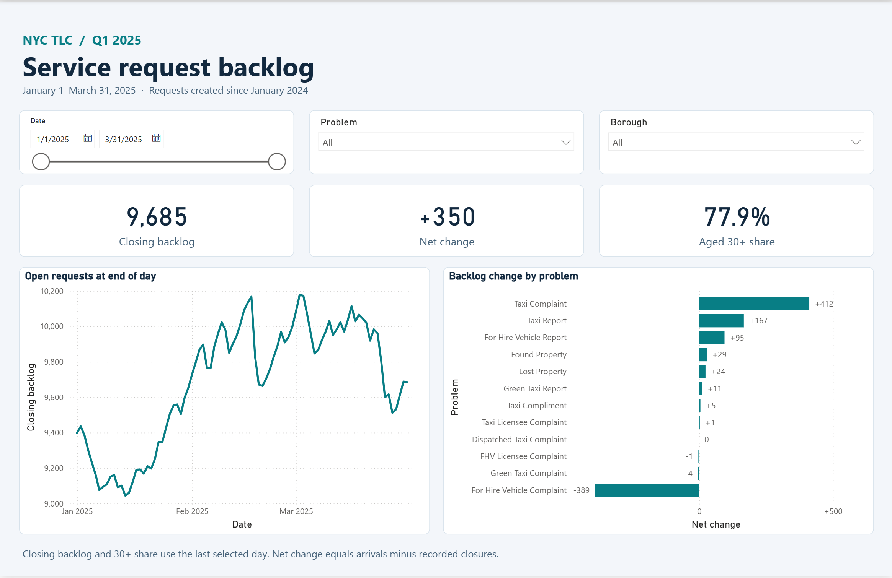

# NYC TLC service request backlog

[Open the live dashboard](https://nyc-tlc-backlog.vercel.app/)

**Review the 20 oldest open Taxi Complaint records.** Taxi Complaint took in 1,757 requests and gained 412 open cases during Q1 2025, the largest increase among TLC categories. For Hire Vehicle Complaint received 4,351 requests and reduced its backlog by 389. A supervisor can use the worklist to inspect the oldest cases and ask where recorded closure is slowing.



## Deliverables

- [Interactive web dashboard](web/index.html) with date, borough, and category filters, four charts, a searchable review queue, and CSV exports. Open the HTML file directly in a browser. It works offline with the included data.
- [Power BI Desktop project](report/NYC%20TLC.pbip) with date, borough and problem filters on Queue health, plus a fixed March 31 review page.
- [Excel review list](report/review-list.xlsx) with 20 records and editable reviewer, action and follow-up fields. The [full March 31 export](exports/open_march31.csv) includes every open category.
- [90-second walkthrough](report/walkthrough.mp4) and [review-page preview](report/previews/march-31-review.png).
- [DuckDB model](sql/build.sql), [citywide source manifest](data/citywide-manifest.json), [TLC extract manifest](data/manifest.json) and [validation results](report/validation.json).

## Findings

| Queue | Jan 1 opening | Q1 arrivals | Q1 recorded closures | Mar 31 open | Net change |
| --- | ---: | ---: | ---: | ---: | ---: |
| All TLC requests | 9,335 | 8,006 | 7,656 | 9,685 | +350 |
| Taxi Complaint | 1,677 | 1,757 | 1,345 | 2,089 | +412 |
| For Hire Vehicle Complaint | 6,290 | 4,351 | 4,740 | 5,901 | −389 |

On March 31, 7,543 open TLC records were at least 30 days old (77.9%). The oldest Taxi Complaint was **59896371**, an open Queens request created on January 1, 2024 and aged 455 days at the cutoff.

## Data and reconciliation

The bulk pipeline scanned **3.02 GB of citywide NYC 311 data (4,341,535 requests)** to derive the 17,341-record TLC cohort. It downloads all agencies and all source fields for the 15 creation months from January 2024 through March 2025, streams monthly CSVs to disk, and checks each partition against an independent API count. The manifest records each partition's download time, row count, byte size, query and SHA-256 checksum. Use a fresh project copy to capture revisions that leave the source row count unchanged. [NYC Open Data](https://data.cityofnewyork.us/Social-Services/311-Service-Requests-from-2020-to-Present/erm2-nwe9)

The report covers January 1–March 31, 2025 and includes carry-in requests created since January 1, 2024. A request is open at day-end if it was created before the next local midnight and its closure is at or after that midnight or absent. Closures count within the reporting day. Age is the difference between local calendar dates. The 30-day threshold supports administrative review. Recorded closure may indicate that an agency saw or began acting on a request, and an absent closure timestamp may overstate backlog. [NYC reporting definitions](https://www.nyc.gov/site/311reporting/faq/faq.page)

The locally derived cohort matched an independent filtered API pull on all eight fields for all 17,341 requests. The Python check reconciles arrivals, closures, open cases and 30-day aging against those source records for all 90 days and all 58 problem-by-borough combinations. It checks each daily roll-forward and every March 31 record and sort position. Power BI DAX returned the same 9,685 closing count for Q1 and March 31 alone, 2,023 in Queens, and the same 20 Taxi Complaint keys as Excel.

## Reproduce on Windows

1. Open PowerShell in this folder and create the Python environment.

   ```powershell
   py -3.11 -m venv .venv
   .\.venv\Scripts\python.exe -m pip install -r requirements-lock.txt
   ```

2. Download the citywide partitions and rebuild the TLC exports. Allow at least 4 GB of free disk space for the bulk CSVs and processing.

   ```powershell
   .\.venv\Scripts\python.exe scripts/fetch_bulk.py
   .\.venv\Scripts\python.exe scripts/build.py
   .\.venv\Scripts\python.exe scripts/validate.py
   .\.venv\Scripts\python.exe -m unittest discover -s tests -v
   ```

   To refresh the SQL model from the local TLC snapshot, start at `build.py`. To pull the narrow API extract into a separate baseline copy, use the starter's `scripts/fetch.py`.

3. Open `report/NYC TLC.pbip` in Power BI Desktop and select **Home → Refresh**. If the project moved, set `ExportFolder` under **Transform data → Edit parameters** to the absolute path of this project's `exports` folder first. The existing exports are enough to refresh the report. [Microsoft Power BI project documentation](https://learn.microsoft.com/en-us/power-bi/developer/projects/projects-overview)

4. Use the supplied workbook or rebuild it with the bundled spreadsheet runtime by running `node scripts/make_worklist.mjs` in an environment that resolves `@oai/artifact-tool`. Rebuilding the workbook resets the three reviewer input columns.

5. After regenerating the SQL exports and validation results, run `.\.venv\Scripts\python.exe scripts/build_web.py` to refresh the browser bundle. Run `node --test tests/test_dashboard.cjs` to compare dashboard totals and the review queue with the validated output.

Vercel builds the production dashboard from `main`. Run `node scripts/build_site.cjs` to assemble the same static site locally in `dist/`.
